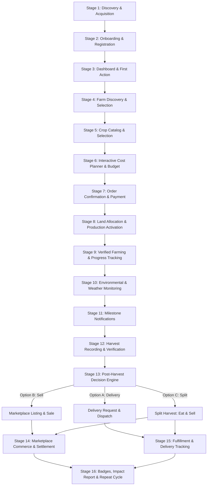

# COMPLETE CUSTOMER JOURNEY: END-TO-END SPECIFICATION

This document details the complete 16-stage customer journey of the AgroConnect platform. It provides the behavioral blueprint, user psychology, data exchanges, UX flow, and edge cases from first discovery to repeat agricultural participation.

---

## High-Level Journey Lifecycle Flow

---

## Detailed Stage-by-Stage Journey Specifications

### STAGE 1: DISCOVERY AND ACQUISITION
* **User Context**: An urban dweller in Ibadan or Lagos sees an Instagram reel, TikTok video, WhatsApp status, or Google search about growing fresh organic tomatoes in Ibadan without owning land.
* **Touchpoint**: Public Acquisition Web Page & Referral Link.
* **Core Value Communicated**:
  - Transparent remote farming operated by verified Nigerian farmers.
  - Predictable food budgeting vs. volatile market food inflation.
  - Honest disclosure: farming involves nature, estimates are scientifically backed, no unrealistic ROI promises.
* **User Actions**:
  - Browses "How It Works" (3-step explainer: Select Farm & Crop → Watch It Grow → Receive Harvest or Sell).
  - Reviews FAQs and customer trust safeguards.
  - Clicks "Download App" or "Launch Web App" with referral code automatically preserved.
* **Edge Cases & Protections**:
  - Referral codes are sanitized and validated to prevent referral fraud.
  - No misleading income guarantees or "passive income" claims.

---

### STAGE 2: REGISTRATION AND ONBOARDING
* **User Context**: First-time application launch on mobile or web.
* **User Experience**:
  - **Visual Walkthrough (3 Swipable Screens)**:
    1. *Real Farms, Real Food*: We partner with verified farmers in Oyo State.
    2. *Track Every Step*: See genuine photos, input logs, and growth stages.
    3. *Harvest on Your Terms*: Get fresh produce delivered to your door or sold to eager buyers.
  - **Frictionless Registration**:
    - Fields: Full Name, Email Address, Phone Number (Nigerian format: `+234...`), Password.
    - Password strength indicator.
    - Optional Referral Code field (pre-filled if clicked from link).
* **Deliberate Exclusion**: **No home address requested at signup** to avoid drop-off; delivery addresses are collected only when a harvest or marketplace order requires dispatch.
* **Data Outcome**: Creation of user in `auth.users` and entry in `public.profiles` with role `consumer`.

---

### STAGE 3: USER DASHBOARD (HOME)
* **User Context**: Authenticated user arrives at the primary cockpit.
* **Dynamic States**:
  - **Zero-State (New Participant)**:
    - Warm welcome header: *"Welcome, [Name]! Ready to grow your first harvest?"*
    - Prominent Hero Card: **"Start Your First Farm"** with an engaging agricultural visual.
    - Quick-start guide: *"3 steps to start cultivating in Ibadan"*.
    - Featured seasonal crops (e.g., *"Roma Tomatoes are in season in Akinyele"*).
  - **Active State (Returning Participant)**:
    - Active Crop Cycle Cards with photo preview, current stage badge (e.g., *Vegetative Growth — Day 24 of 75*), and estimated harvest countdown.
    - Recent Farm Update Feed (e.g., *"Farmer Samuel applied organic compost at Ido Farm yesterday"*).
    - Quick Action Buttons: "View Live Farm", "Cost Estimator", "Marketplace".
    - Notification bell with unread count.

---

### STAGE 4: FARM DISCOVERY AND SELECTION
* **User Context**: User taps "Start Your Farm" or explores partner farms.
* **Geographical Scope**: Ibadan, Oyo State (Ido, Akinyele, Oluyole, Lagelu, Egbeda).
* **Interface**:
  - **Interactive Map View**: Displays verified farm clusters around Ibadan using OpenStreetMap tiles with custom markers.
  - **Filter & List View**: Toggle between Map and Cards. Filter by distance, water system (Borehole / Drip Irrigation / Rainfed), and verification status.
* **Farm Detail Profile**:
  - Verified badge with inspection date by AgroConnect Operations.
  - Farm operator name and background.
  - Acreage, soil classification (e.g., sandy loam), and irrigation infrastructure.
  - Photo gallery showing real on-site infrastructure (solar pump, storage shed, nursery beds).
  - Supported crops currently ready for onboarding.
* **Legal Clarity**: Explicit alert banner: *"Participating allocates a crop-production service unit at this farm for one cycle. It does not confer real estate ownership."*

---

### STAGE 5: CROP DISCOVERY AND SELECTION
* **User Context**: Participant chooses which crop to cultivate at the selected farm.
* **Crop Catalog**:
  - High-resolution imagery of genuine crops: Tomatoes, Habanero Pepper (Atarodo), Bell Pepper (Tatase), Sweet Corn/Maize, Cassava, Plantain, Okra, Ugu (Fluted Pumpkin).
  - Badges indicating cultivation difficulty, water demand, and seasonal suitability.
* **Crop Detail Screen**:
  - **Cultivation Timeline**: e.g., 75–90 days from seedling transplant to maturity.
  - **Agronomic Requirements**: Soil type, expected sunlight, disease risk factors.
  - **Realistic Harvest Range**: e.g., *"Estimated yield: 180 kg – 240 kg per 50 sqm plot under optimal management"*.
  - **Available Packages**: Standard Plot (50 sqm), Family Plot (100 sqm), Commercial Unit (250 sqm).

---

### STAGE 6: INTERACTIVE PRODUCTION PLANNER & COST ESTIMATOR
* **User Context**: The participant tests what production involves financially before making any commitment.
* **Interactive Parameters**:
  - Plot Size slider / selector (e.g., 50 sqm, 100 sqm, 250 sqm).
  - Package Tier (e.g., Standard Input vs. Premium Organic).
* **Dynamic Itemized Budget Breakdown**:
  - Land Preparation & Ridging: ₦...
  - Certified Seeds / Seedling Nursery: ₦...
  - Organic Soil Amendments & Compost: ₦...
  - Irrigation & Water Access Fee: ₦...
  - Pest & Disease Management (Bio-protection): ₦...
  - Skilled Labor & Farming Operations: ₦...
  - Harvest Labor & Sorting: ₦...
  - Platform Technology & Verification Fee: ₦...
* **Key Calculated Indicators**:
  - **Total Production Investment**: ₦ Total.
  - **Estimated Produce Yield**: e.g., 200 kg.
  - **Effective Cost per Kilogram**: e.g., ₦650/kg (compared against current Ibadan retail average of ₦1,200/kg).
  - **Disclaimer**: *"Agricultural production is subject to environmental and biological variation. Final yields may vary above or below estimates."*

---

### STAGE 7: PRODUCTION CONFIRMATION AND PAYMENT
* **User Context**: User decides to fund their chosen crop cycle.
* **Order Review Screen**:
  - Detailed summary of selected farm, plot size, crop, target start date, and total amount.
  - Acceptance of **Agricultural Production Terms & Conditions** (checkbox required).
* **Payment Processing**:
  - **Architecture**: Modular payment gateway abstraction.
  - **Development Sandbox**: Interactive mock payment simulation supporting Test Success, Test Failure, and Test Cancel states.
  - **Live Mode (Configurable)**: Paystack integration supporting Debit Cards, Bank Transfer, USSD, and Mobile Money.
* **Security Guardrail**:
  - Frontend payment callbacks are treated as **untrusted indicators**.
  - Order status is only confirmed upon cryptographic server-side webhook signature verification (`x-paystack-signature` via HMAC-SHA512).

---

### STAGE 8: FARM ALLOCATION AND PRODUCTION ACTIVATION
* **System Actions Upon Payment Confirmation**:
  1. Record created in `production_orders` with status `awaiting_allocation`.
  2. Platform operations team or designated farm operator receives notification.
  3. Operator verifies seed/nursery availability and assigns a specific numbered plot (e.g., `Plot B-14, Ido Farm`).
  4. Status transitions to `allocated`, then `land_preparation`.
  5. Participant receives push notification: *"Your tomato plot at Ido Farm has been assigned to Farmer Samuel!"*

---

### STAGE 9: VERIFIED FARMING AND PROGRESS TRACKING
* **User Context**: The central emotional experience of the platform.
* **Progress Interface**:
  - Visual timeline representing stages:
    1. Land Preparation & Soil Tillage
    2. Nursery & Seedling Transplanting
    3. Vegetative Growth & Weeding
    4. Flowering & Fruit Setting
    5. Fruit Maturation & Pest Inspection
    6. Harvest Readiness
* **Activity Stream**:
  - Each activity card features:
    - High-resolution photograph or video clip taken on site.
    - Farmer's notes (e.g., *"Completed second weeding and applied neem extract spray for aphid prevention"*).
    - Inputs used with exact quantities.
    - Timestamp and weather condition at time of activity.
* **Anti-Fabrication Policy**:
  - All farmer submissions pass through an **Admin Approval Gate** before appearing on the user feed.
  - Growth indicators only advance when verified farm activities are recorded.

---

### STAGE 10: WEATHER AND FARM ENVIRONMENTAL DATA
* **User Context**: Transparency regarding real-world environmental factors affecting the crop.
* **Display Elements**:
  - Farm location current temperature and weather icon.
  - 7-day rainfall forecast for the specific LGA in Oyo State.
  - Soil moisture index (where field sensors or manual logs exist).
  - Historical weather incidents (e.g., *"Heavy rain recorded on Tuesday; drainage ditches cleared by farm crew"*).

---

### STAGE 11: NOTIFICATIONS AND ENGAGEMENT
* **Notification Channels**: In-app Notification Center, Push Notifications (via Expo), Email summary (transaction receipts).
* **Key Event Triggers**:
  - Activity Approved: *"New photos from your pepper plot at Akinyele Farm."*
  - Farming Milestone: *"Your maize has begun tasseling!"*
  - Anomaly Alert: *"Minor heatwave reported in Ibadan. Supplemental drip irrigation scheduled."*
  - Harvest Countdown: *"Harvest estimated in 10 days. Please review your post-harvest choices."*

---

### STAGE 12: HARVEST MANAGEMENT & RECORDING
* **Field Operator Action**:
  - Farmer harvests plot under supervisor oversight.
  - Logs actual metrics: Date of harvest, gross weight (kg), grade breakdown (Grade A / Premium, Grade B, Damaged/Rejected), and photographic evidence of crate sorting.
* **Admin Verification**: Platform operator reviews weights and validates scale photos.
* **Participant Reveal**:
  - Notification: *"Harvest Complete! Your plot yielded 215 kg of fresh Roma tomatoes."*
  - Comparison graph: Estimated Yield (200 kg) vs. Actual Yield (215 kg).

---

### STAGE 13: POST-HARVEST DECISION ENGINE
* **User Context**: Participant chooses what to do with their actual harvested yield.
* **Three Flexible Options**:
  - **Option A: Doorstep Delivery (Home Consumption)**:
    - User inputs recipient name, phone, and delivery address in Ibadan (or supported cities).
    - Delivery fee calculated based on zone.
    - Preferred delivery time window selected (e.g., Saturday morning).
  - **Option B: Sell on AgroConnect Marketplace**:
    - User lists all or part of the produce for sale to marketplace buyers.
    - Recommended market price per kg provided; user sets sale price within reasonable guardrails.
    - Transparent display of platform commission (e.g., 10%) and net payable proceeds.
  - **Option C: Split Allocation (Eat Some, Sell Some)**:
    - Interactive slider: e.g., "Deliver 50 kg to my home; list 165 kg on the marketplace".

---

### STAGE 14: MARKETPLACE COMMERCE
* **User Context**: Urban buyers (restaurants, families, bulk consumers) buy fresh, farm-traceable produce.
* **Marketplace Features**:
  - Real-time catalog of available produce with farm origin, harvest date, and farmer profile.
  - Real-time inventory locking to prevent double-selling.
  - Add to cart, quantity increments (kg/crates).
  - Delivery address collection and delivery fee calculation.
  - Payment checkout via Paystack or Mock Gateway.
  - Order tracking: *Order Placed → Packed at Farm → Out for Delivery → Delivered*.

---

### STAGE 15: PAYMENT SETTLEMENT & SELLER PROCEEDS
* **User Context**: Participant who listed produce on the marketplace receives sales revenue.
* **Settlement Engine**:
  - When a marketplace order is fulfilled and marked delivered, the corresponding portion of sales proceeds is credited to the participant's account balance.
  - Ledger breakdown: Gross Produce Sales - Platform Commission - Handling Fee = Net Payout.
  - Payout request: Participant inputs Nigerian bank details (NUBAN, Bank Name), validated via Paystack Bank Resolution API.
  - Settlement log generated with immutable audit trail.

---

### STAGE 16: CUSTOMER RETENTION AND GAMIFICATION
* **User Context**: The cycle ends, but the agricultural journey continues.
* **Retention Mechanics**:
  - **Harvest Impact Summary**:
    - Total kilograms grown.
    - Money saved compared to open-market supermarket prices.
    - Carbon footprint reduction / support for local Oyo State smallholders.
  - **Farming Badges & Achievements**:
    - *"First Seed Sprouted"*, *"Master Tomato Grower"*, *"Zero Waste Farmer"*, *"Community Feeder"*.
  - **Next Season Re-investment Incentive**:
    - Priority plot reservation for upcoming seasonal planting (e.g., Sweet Corn in the early rains).
    - 1-click re-ordering of proven crop packages.
