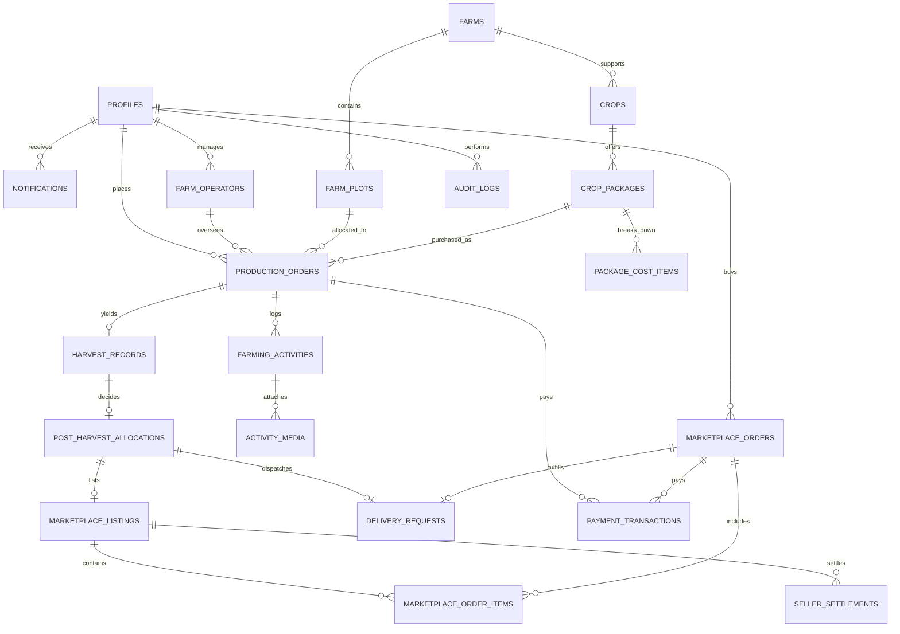

# DATABASE DESIGN & DATA MODEL: AGROCONNECT PLATFORM

This document defines the complete relational schema, table structures, foreign keys, enum types, constraints, Row Level Security (RLS) policies, and indexing strategy for the AgroConnect PostgreSQL database on Supabase.

---

## 1. Entity-Relationship Diagram (ERD)



---

## 2. PostgreSQL Enumerated Types

```sql
-- User roles
CREATE TYPE user_role AS ENUM ('consumer', 'farmer', 'admin', 'buyer');

-- Crop production cycle statuses
CREATE TYPE cycle_status AS ENUM (
  'awaiting_payment',
  'awaiting_allocation',
  'allocated',
  'land_preparation',
  'planting',
  'growing',
  'maintenance',
  'harvest_ready',
  'harvested',
  'completed',
  'disrupted',
  'cancelled'
);

-- Payment statuses
CREATE TYPE payment_status AS ENUM ('pending', 'successful', 'failed', 'refunded');

-- Activity review statuses
CREATE TYPE activity_status AS ENUM ('draft', 'pending_approval', 'approved', 'rejected');

-- Post harvest decision options
CREATE TYPE post_harvest_option AS ENUM ('delivery', 'marketplace', 'split');

-- Delivery fulfillment statuses
CREATE TYPE delivery_status AS ENUM (
  'awaiting_confirmation',
  'ready_for_dispatch',
  'dispatched',
  'in_transit',
  'delivered',
  'failed',
  'returned'
);

-- Settlement statuses
CREATE TYPE settlement_status AS ENUM ('pending', 'processing', 'completed', 'disputed');
```

---

## 3. Core Table Definitions & Schema Specifications

### 3.1. `profiles` (Extended User Identity)
Linked 1:1 with `auth.users` via Supabase Auth triggers.
```sql
CREATE TABLE public.profiles (
  id UUID PRIMARY KEY REFERENCES auth.users(id) ON DELETE CASCADE,
  role user_role NOT NULL DEFAULT 'consumer',
  full_name TEXT NOT NULL,
  email TEXT UNIQUE NOT NULL,
  phone_number TEXT,
  avatar_url TEXT,
  preferred_location TEXT DEFAULT 'Ibadan',
  referral_code TEXT UNIQUE,
  referred_by UUID REFERENCES public.profiles(id),
  created_at TIMESTAMPTZ NOT NULL DEFAULT timezone('utc', now()),
  updated_at TIMESTAMPTZ NOT NULL DEFAULT timezone('utc', now())
);
```

### 3.2. `farms` (Partner Farm Records)
Represents physical agricultural locations in Oyo State.
```sql
CREATE TABLE public.farms (
  id UUID PRIMARY KEY DEFAULT gen_random_uuid(),
  name TEXT NOT NULL,
  slug TEXT UNIQUE NOT NULL,
  description TEXT NOT NULL,
  state TEXT NOT NULL DEFAULT 'Oyo',
  lga TEXT NOT NULL, -- e.g., 'Ido', 'Akinyele', 'Oluyole'
  address_description TEXT NOT NULL,
  latitude NUMERIC(10, 7) NOT NULL,
  longitude NUMERIC(10, 7) NOT NULL,
  total_area_sqm NUMERIC(12, 2) NOT NULL,
  available_area_sqm NUMERIC(12, 2) NOT NULL,
  soil_type TEXT NOT NULL, -- e.g., 'Sandy Loam', 'Rich Alluvial'
  water_source TEXT NOT NULL, -- e.g., 'Industrial Solar Borehole & Drip'
  is_verified BOOLEAN NOT NULL DEFAULT false,
  verified_at TIMESTAMPTZ,
  cover_image_url TEXT,
  gallery_urls TEXT[] DEFAULT '{}',
  created_at TIMESTAMPTZ NOT NULL DEFAULT timezone('utc', now()),
  updated_at TIMESTAMPTZ NOT NULL DEFAULT timezone('utc', now())
);
```

### 3.3. `farm_operators` (Farmer Profiles)
```sql
CREATE TABLE public.farm_operators (
  id UUID PRIMARY KEY DEFAULT gen_random_uuid(),
  profile_id UUID NOT NULL REFERENCES public.profiles(id) ON DELETE CASCADE,
  farm_id UUID NOT NULL REFERENCES public.farms(id) ON DELETE CASCADE,
  specialization TEXT NOT NULL, -- e.g., 'Horticulture, Solanaceous Crops'
  years_of_experience INTEGER NOT NULL,
  id_document_url TEXT,
  is_active BOOLEAN NOT NULL DEFAULT true,
  rating NUMERIC(3, 2) DEFAULT 5.0,
  created_at TIMESTAMPTZ NOT NULL DEFAULT timezone('utc', now())
);
```

### 3.4. `farm_plots` (Farmland Inventory & Partitioning)
```sql
CREATE TABLE public.farm_plots (
  id UUID PRIMARY KEY DEFAULT gen_random_uuid(),
  farm_id UUID NOT NULL REFERENCES public.farms(id) ON DELETE CASCADE,
  plot_code TEXT NOT NULL, -- e.g., 'IDO-BLK-A12'
  area_sqm NUMERIC(10, 2) NOT NULL,
  status TEXT NOT NULL DEFAULT 'available' CHECK (status IN ('available', 'allocated', 'fallow', 'under_maintenance')),
  current_crop_id UUID,
  created_at TIMESTAMPTZ NOT NULL DEFAULT timezone('utc', now()),
  UNIQUE(farm_id, plot_code)
);
```

### 3.5. `crops` (Agricultural Produce Catalog)
```sql
CREATE TABLE public.crops (
  id UUID PRIMARY KEY DEFAULT gen_random_uuid(),
  name TEXT NOT NULL, -- e.g., 'Roma Tomato'
  botanical_name TEXT, -- 'Solanum lycopersicum'
  category TEXT NOT NULL, -- 'Vegetable', 'Legume', 'Grain', 'Root/Tuber'
  description TEXT NOT NULL,
  growth_duration_days INTEGER NOT NULL, -- e.g., 75
  planting_season TEXT NOT NULL, -- e.g., 'All-year (Irrigated), Mar-Oct (Rainfed)'
  water_requirement TEXT NOT NULL, -- 'High', 'Moderate', 'Low'
  soil_requirement TEXT NOT NULL,
  pest_and_disease_notes TEXT NOT NULL,
  image_url TEXT NOT NULL,
  is_active BOOLEAN NOT NULL DEFAULT true,
  created_at TIMESTAMPTZ NOT NULL DEFAULT timezone('utc', now())
);
```

### 3.6. `crop_packages` (Production Packages)
Configurable units of cultivation available for purchase.
```sql
CREATE TABLE public.crop_packages (
  id UUID PRIMARY KEY DEFAULT gen_random_uuid(),
  crop_id UUID NOT NULL REFERENCES public.crops(id) ON DELETE CASCADE,
  name TEXT NOT NULL, -- e.g., 'Starter Plot (50 sqm)'
  plot_size_sqm NUMERIC(10, 2) NOT NULL,
  target_yield_min_kg NUMERIC(10, 2) NOT NULL,
  target_yield_max_kg NUMERIC(10, 2) NOT NULL,
  base_production_cost NUMERIC(12, 2) NOT NULL, -- Naira
  platform_fee NUMERIC(12, 2) NOT NULL, -- Naira
  total_price NUMERIC(12, 2) NOT NULL, -- Naira (base + fee)
  is_active BOOLEAN NOT NULL DEFAULT true,
  created_at TIMESTAMPTZ NOT NULL DEFAULT timezone('utc', now())
);
```

### 3.7. `package_cost_items` (Itemized Budget Breakdown)
Transparent financial schedule for each package.
```sql
CREATE TABLE public.package_cost_items (
  id UUID PRIMARY KEY DEFAULT gen_random_uuid(),
  package_id UUID NOT NULL REFERENCES public.crop_packages(id) ON DELETE CASCADE,
  category TEXT NOT NULL, -- 'Land Prep', 'Seeds', 'Inputs', 'Irrigation', 'Labor', 'Insurance/Contingency'
  item_name TEXT NOT NULL,
  estimated_cost NUMERIC(12, 2) NOT NULL,
  is_mandatory BOOLEAN NOT NULL DEFAULT true,
  sort_order INTEGER NOT NULL DEFAULT 0
);
```

### 3.8. `production_orders` / `crop_cycles` (Central Cycle Record)
```sql
CREATE TABLE public.production_orders (
  id UUID PRIMARY KEY DEFAULT gen_random_uuid(),
  cycle_code TEXT UNIQUE NOT NULL, -- 'CYC-2026-0001'
  user_id UUID NOT NULL REFERENCES public.profiles(id) ON DELETE RESTRICT,
  farm_id UUID NOT NULL REFERENCES public.farms(id) ON DELETE RESTRICT,
  crop_id UUID NOT NULL REFERENCES public.crops(id) ON DELETE RESTRICT,
  package_id UUID NOT NULL REFERENCES public.crop_packages(id) ON DELETE RESTRICT,
  plot_id UUID REFERENCES public.farm_plots(id) ON DELETE SET NULL,
  farmer_id UUID REFERENCES public.farm_operators(id) ON DELETE SET NULL,
  status cycle_status NOT NULL DEFAULT 'awaiting_payment',
  payment_status payment_status NOT NULL DEFAULT 'pending',
  total_amount NUMERIC(12, 2) NOT NULL,
  target_start_date DATE,
  actual_start_date DATE,
  estimated_harvest_start DATE,
  estimated_harvest_end DATE,
  actual_harvest_date DATE,
  cancellation_reason TEXT,
  created_at TIMESTAMPTZ NOT NULL DEFAULT timezone('utc', now()),
  updated_at TIMESTAMPTZ NOT NULL DEFAULT timezone('utc', now())
);
```

### 3.9. `farming_activities` (Farmer Field Activity Logs)
```sql
CREATE TABLE public.farming_activities (
  id UUID PRIMARY KEY DEFAULT gen_random_uuid(),
  production_order_id UUID NOT NULL REFERENCES public.production_orders(id) ON DELETE CASCADE,
  farmer_id UUID NOT NULL REFERENCES public.farm_operators(id) ON DELETE RESTRICT,
  stage_name TEXT NOT NULL, -- 'Land Preparation', 'Transplanting', 'Irrigation', 'Fertilization', etc.
  title TEXT NOT NULL,
  description TEXT NOT NULL,
  activity_date DATE NOT NULL,
  inputs_applied JSONB DEFAULT '{}', -- e.g., {"type": "Organic NPK", "quantity": "2.5kg"}
  weather_condition TEXT, -- 'Sunny, 31C'
  status activity_status NOT NULL DEFAULT 'pending_approval',
  reviewed_by UUID REFERENCES public.profiles(id),
  reviewed_at TIMESTAMPTZ,
  rejection_reason TEXT,
  created_at TIMESTAMPTZ NOT NULL DEFAULT timezone('utc', now())
);
```

### 3.10. `activity_media` (Photos & Videos)
```sql
CREATE TABLE public.activity_media (
  id UUID PRIMARY KEY DEFAULT gen_random_uuid(),
  activity_id UUID NOT NULL REFERENCES public.farming_activities(id) ON DELETE CASCADE,
  media_type TEXT NOT NULL CHECK (media_type IN ('image', 'video')),
  media_url TEXT NOT NULL,
  caption TEXT,
  created_at TIMESTAMPTZ NOT NULL DEFAULT timezone('utc', now())
);
```

### 3.11. `harvest_records` (Field Harvest Results)
```sql
CREATE TABLE public.harvest_records (
  id UUID PRIMARY KEY DEFAULT gen_random_uuid(),
  production_order_id UUID UNIQUE NOT NULL REFERENCES public.production_orders(id) ON DELETE RESTRICT,
  harvest_date DATE NOT NULL,
  gross_quantity_kg NUMERIC(10, 2) NOT NULL,
  grade_a_quantity_kg NUMERIC(10, 2) NOT NULL,
  grade_b_quantity_kg NUMERIC(10, 2) NOT NULL,
  rejected_quantity_kg NUMERIC(10, 2) NOT NULL DEFAULT 0,
  proof_image_urls TEXT[] DEFAULT '{}',
  notes TEXT,
  recorded_by UUID NOT NULL REFERENCES public.farm_operators(id),
  verified_by UUID REFERENCES public.profiles(id),
  created_at TIMESTAMPTZ NOT NULL DEFAULT timezone('utc', now())
);
```

### 3.12. `post_harvest_allocations` (Participant Decisions)
```sql
CREATE TABLE public.post_harvest_allocations (
  id UUID PRIMARY KEY DEFAULT gen_random_uuid(),
  harvest_record_id UUID UNIQUE NOT NULL REFERENCES public.harvest_records(id) ON DELETE RESTRICT,
  user_id UUID NOT NULL REFERENCES public.profiles(id) ON DELETE RESTRICT,
  decision post_harvest_option NOT NULL,
  delivery_quantity_kg NUMERIC(10, 2) DEFAULT 0,
  marketplace_quantity_kg NUMERIC(10, 2) DEFAULT 0,
  status TEXT NOT NULL DEFAULT 'processing' CHECK (status IN ('processing', 'fulfilled', 'cancelled')),
  created_at TIMESTAMPTZ NOT NULL DEFAULT timezone('utc', now())
);
```

### 3.13. `marketplace_listings` (Produce for Sale)
```sql
CREATE TABLE public.marketplace_listings (
  id UUID PRIMARY KEY DEFAULT gen_random_uuid(),
  seller_id UUID NOT NULL REFERENCES public.profiles(id) ON DELETE RESTRICT,
  harvest_record_id UUID REFERENCES public.harvest_records(id),
  crop_id UUID NOT NULL REFERENCES public.crops(id) ON DELETE RESTRICT,
  title TEXT NOT NULL,
  description TEXT NOT NULL,
  price_per_kg NUMERIC(10, 2) NOT NULL,
  total_quantity_kg NUMERIC(10, 2) NOT NULL,
  available_quantity_kg NUMERIC(10, 2) NOT NULL,
  unit TEXT NOT NULL DEFAULT 'kg', -- 'kg', 'crate', 'basket'
  image_urls TEXT[] DEFAULT '{}',
  is_approved BOOLEAN NOT NULL DEFAULT false,
  status TEXT NOT NULL DEFAULT 'active' CHECK (status IN ('active', 'sold_out', 'delisted')),
  created_at TIMESTAMPTZ NOT NULL DEFAULT timezone('utc', now())
);
```

### 3.14. `marketplace_orders` & `marketplace_order_items`
```sql
CREATE TABLE public.marketplace_orders (
  id UUID PRIMARY KEY DEFAULT gen_random_uuid(),
  order_code TEXT UNIQUE NOT NULL, -- 'ORD-2026-0001'
  buyer_id UUID NOT NULL REFERENCES public.profiles(id) ON DELETE RESTRICT,
  status TEXT NOT NULL DEFAULT 'pending' CHECK (status IN ('pending', 'paid', 'preparing', 'dispatched', 'delivered', 'cancelled')),
  subtotal NUMERIC(12, 2) NOT NULL,
  delivery_fee NUMERIC(12, 2) NOT NULL DEFAULT 0,
  total_amount NUMERIC(12, 2) NOT NULL,
  delivery_address JSONB NOT NULL,
  created_at TIMESTAMPTZ NOT NULL DEFAULT timezone('utc', now())
);

CREATE TABLE public.marketplace_order_items (
  id UUID PRIMARY KEY DEFAULT gen_random_uuid(),
  order_id UUID NOT NULL REFERENCES public.marketplace_orders(id) ON DELETE CASCADE,
  listing_id UUID NOT NULL REFERENCES public.marketplace_listings(id) ON DELETE RESTRICT,
  quantity_kg NUMERIC(10, 2) NOT NULL,
  unit_price NUMERIC(10, 2) NOT NULL,
  total_price NUMERIC(12, 2) NOT NULL
);
```

### 3.15. `delivery_requests` (Logistics Management)
```sql
CREATE TABLE public.delivery_requests (
  id UUID PRIMARY KEY DEFAULT gen_random_uuid(),
  tracking_number TEXT UNIQUE NOT NULL, -- 'DEL-IBD-0001'
  source_type TEXT NOT NULL CHECK (source_type IN ('harvest_choice', 'marketplace_order')),
  source_id UUID NOT NULL,
  recipient_name TEXT NOT NULL,
  recipient_phone TEXT NOT NULL,
  destination_address TEXT NOT NULL,
  city TEXT NOT NULL DEFAULT 'Ibadan',
  state TEXT NOT NULL DEFAULT 'Oyo',
  status delivery_status NOT NULL DEFAULT 'awaiting_confirmation',
  dispatch_notes TEXT,
  dispatched_at TIMESTAMPTZ,
  delivered_at TIMESTAMPTZ,
  created_at TIMESTAMPTZ NOT NULL DEFAULT timezone('utc', now())
);
```

### 3.16. `payment_transactions` (Financial Ledger)
```sql
CREATE TABLE public.payment_transactions (
  id UUID PRIMARY KEY DEFAULT gen_random_uuid(),
  transaction_ref TEXT UNIQUE NOT NULL, -- 'TX-AGRO-...'
  user_id UUID NOT NULL REFERENCES public.profiles(id),
  purpose TEXT NOT NULL CHECK (purpose IN ('production_order', 'marketplace_order', 'delivery_fee')),
  reference_id UUID NOT NULL,
  amount NUMERIC(12, 2) NOT NULL,
  currency TEXT NOT NULL DEFAULT 'NGN',
  provider TEXT NOT NULL DEFAULT 'paystack', -- 'mock', 'paystack'
  status payment_status NOT NULL DEFAULT 'pending',
  gateway_response JSONB DEFAULT '{}',
  created_at TIMESTAMPTZ NOT NULL DEFAULT timezone('utc', now()),
  updated_at TIMESTAMPTZ NOT NULL DEFAULT timezone('utc', now())
);
```

### 3.17. `seller_settlements` (Seller Payout Ledger)
```sql
CREATE TABLE public.seller_settlements (
  id UUID PRIMARY KEY DEFAULT gen_random_uuid(),
  seller_id UUID NOT NULL REFERENCES public.profiles(id),
  listing_id UUID NOT NULL REFERENCES public.marketplace_listings(id),
  gross_sales NUMERIC(12, 2) NOT NULL,
  platform_commission NUMERIC(12, 2) NOT NULL,
  net_payable NUMERIC(12, 2) NOT NULL,
  bank_name TEXT NOT NULL,
  account_number TEXT NOT NULL,
  account_name TEXT NOT NULL,
  status settlement_status NOT NULL DEFAULT 'pending',
  payout_reference TEXT,
  settled_at TIMESTAMPTZ,
  created_at TIMESTAMPTZ NOT NULL DEFAULT timezone('utc', now())
);
```

### 3.18. `notifications` & `audit_logs`
```sql
CREATE TABLE public.notifications (
  id UUID PRIMARY KEY DEFAULT gen_random_uuid(),
  user_id UUID NOT NULL REFERENCES public.profiles(id) ON DELETE CASCADE,
  title TEXT NOT NULL,
  message TEXT NOT NULL,
  type TEXT NOT NULL, -- 'milestone', 'activity', 'payment', 'delivery', 'system'
  link_url TEXT,
  is_read BOOLEAN NOT NULL DEFAULT false,
  created_at TIMESTAMPTZ NOT NULL DEFAULT timezone('utc', now())
);

CREATE TABLE public.audit_logs (
  id UUID PRIMARY KEY DEFAULT gen_random_uuid(),
  actor_id UUID REFERENCES public.profiles(id),
  action TEXT NOT NULL, -- e.g., 'approve_activity', 'allocate_plot', 'verify_farm'
  target_table TEXT NOT NULL,
  target_id UUID,
  metadata JSONB DEFAULT '{}',
  created_at TIMESTAMPTZ NOT NULL DEFAULT timezone('utc', now())
);
```

---

## 4. Row Level Security (RLS) Policies Strategy

All tables enable RLS (`ALTER TABLE ... ENABLE ROW LEVEL SECURITY;`).

1. **Helper Function for Admin Identification**:
   ```sql
   CREATE OR REPLACE FUNCTION public.is_admin()
   RETURNS BOOLEAN AS $$
     SELECT EXISTS (
       SELECT 1 FROM public.profiles
       WHERE id = auth.uid() AND role = 'admin'
     );
   $$ LANGUAGE sql SECURITY DEFINER;
   ```

2. **`production_orders` Policy**:
   - Participants can `SELECT` and `INSERT` orders where `user_id = auth.uid()`.
   - Farmers can `SELECT` orders where `farmer_id IN (SELECT id FROM public.farm_operators WHERE profile_id = auth.uid())`.
   - Admins can perform all actions (`SELECT`, `UPDATE`, `DELETE`).

3. **`farming_activities` Policy**:
   - Approved activities (`status = 'approved'`) are readable by all authenticated participants of the cycle.
   - Assigned farmers can `INSERT` and `UPDATE` their own draft/pending activities.
   - Only Admins can execute `UPDATE status = 'approved'` or `'rejected'`.

4. **`marketplace_listings` Policy**:
   - Active, approved listings (`status = 'active' AND is_approved = true`) are readable by everyone (public).
   - Sellers can manage their own listings.

---

## 5. Performance Indexing Strategy

```sql
-- High-frequency joins and status filters
CREATE INDEX idx_production_orders_user ON public.production_orders(user_id);
CREATE INDEX idx_production_orders_status ON public.production_orders(status);
CREATE INDEX idx_farming_activities_order ON public.farming_activities(production_order_id, status);
CREATE INDEX idx_marketplace_listings_status ON public.marketplace_listings(status, is_approved);
CREATE INDEX idx_notifications_user_unread ON public.notifications(user_id, is_read);
CREATE INDEX idx_payment_transactions_ref ON public.payment_transactions(transaction_ref);
```
