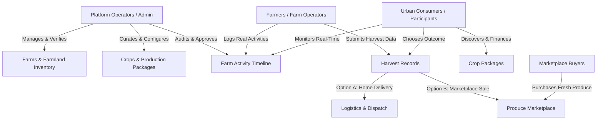

# PROJECT BRIEF: AGROCONNECT NIGERIA (REAL-WORLD GAMIFIED FARMING PLATFORM)

## 1. Executive Summary

**AgroConnect** (working title) is a mobile-first agricultural technology platform that enables urban residents, families, and professionals across Nigeria—starting with **Ibadan, Oyo State**—to participate directly in real-world farming without needing to acquire farmland, manage physical labour, or possess agronomic expertise.

Unlike farming simulation games, AgroConnect is a digital interface to physical agricultural production. Urban participants choose farms, select crop packages, follow verified crop lifecycles through photographic and video activity updates, and either receive their harvested produce directly at their doorstep or list it for sale on an integrated marketplace.

The platform addresses systemic agricultural bottlenecks in Nigeria: high urban retail food prices, severe post-harvest losses, farmer liquidity shortages, and the total disconnection between urban consumer demand and rural agricultural production.

---

## 2. Core Value Proposition & Positioning

### For Urban Consumers & Household Farm Participants
- **Food Security & Savings**: Grow staple foods (e.g., tomatoes, peppers, maize, plantain, cassava) at predictable farm-gate production costs rather than inflated open-market retail prices.
- **Traceability & Transparency**: Know the exact farm, soil, inputs, and farmer responsible for your food.
- **Remote Ownership Experience**: Experience the emotional and educational joy of farming through a gamified, visual interface without leaving the city.
- **Flexible Harvest Outcomes**: Eat what you grow, sell the surplus on the marketplace to recoup costs, or split the harvest.

### For Farmers & Agricultural Land Operators
- **Pre-Financed Crop Cycles**: Farmers gain guaranteed working capital and secured demand before seeds are placed in the ground.
- **Zero Market Risk / Reduced Post-Harvest Waste**: Produce is pre-purchased or backed by committed urban participants.
- **Digital Infrastructure**: Simple tools to record activities, document input applications, and demonstrate expertise to a broader market.

### What the Platform IS NOT (Anti-Patterns)
- **NOT an Unregistered Investment Scheme / Ponzi**: The platform **strictly avoids** promising fixed financial returns, guaranteed yields, or interest rates. Agriculture inherently carries weather, pest, and market risks. All figures are presented as *scientific estimates and ranges*.
- **NOT a Virtual Farm Simulation Game**: Milestones and timelines are driven by **actual verified farm events**, not arbitrary client-side timers or synthetic timers.
- **NOT Land Ownership Transfer**: Unless explicitly leased under legal instruments, participation represents a **crop-production service package**, not ownership of the underlying real estate.

---

## 3. The Problem Landscape in Nigeria

1. **High Urban Food Inflation**: Food prices in Nigerian cities fluctuate wildly due to middlemen markups, logistics costs, and speculation.
2. **Post-Harvest Losses**: Over 40% of perishable crops in Nigeria rot before reaching urban centers due to poor logistics, fragmented markets, and lack of cold storage.
3. **Urban Farm Aspiration vs. Reality**: Millions of urban residents wish to farm but are blocked by land tenure constraints, distance, security concerns, rural labor unreliability, and lack of agronomic know-how.
4. **Underutilized Farmland**: Substantial agricultural acreage around peri-urban zones like Ibadan remains fallow or under-productive due to capital and market linkage shortages.

---

## 4. Key Platform Roles & Stakeholder Capabilities

### A. Consumers / Farm Participants
- Onboard smoothly and learn how remote production operates.
- Discover partner farms around Ibadan with transparent data on soil, water sources, and operator credentials.
- Browse available crops and compare cultivation periods, packages, and itemized cost breakdowns.
- Use the **Interactive Production Calculator** to evaluate costs, estimated harvest ranges, and cost-per-kg before committing.
- Fund production securely via card, bank transfer, or USSD (Nigerian payment gateways, e.g., Paystack).
- Follow farming progress via a chronological timeline containing farmer-uploaded photos, video snippets, and input records.
- Make post-harvest choices: Request doorstep delivery, list produce on the marketplace, or split between both.

### B. Farmers / Farm Operators
- View allocated plots and assigned participant crop cycles.
- Log field activities directly: land prep, planting, weeding, fertilization, pest control, irrigation, and harvesting.
- Attach photographic and video proof to every logged action.
- Report field challenges (weather anomalies, pest sightings) immediately for administrative remediation.
- Record actual harvested weights, grades, and rejected quantities.

### C. Administrators / Platform Operators
- Full operational control via a responsive web dashboard.
- Farm onboarding, plot allocation, and operator assignment.
- Crop catalog configuration (cultivation days, seasonal calendars, itemized budget templates, risk warnings).
- Content moderation: Review and approve/reject farmer activity updates before participants see them.
- Harvest verification and discrepancy management.
- Marketplace oversight, order fulfillment, delivery routing, and financial settlements.

### D. Marketplace Buyers
- Browse fresh produce with authenticated farm origin and harvest dates.
- Filter by crop category, price, and farm origin.
- Add items to cart, select delivery address within delivery zones, and checkout securely.
- Track delivery progress from dispatch to doorstep.

---

## 5. Geographical & Operational Strategy

### Phase 1 Validation Focus: Ibadan, Oyo State, Nigeria
- **Why Ibadan?** 
  - Proximity to abundant fertile peri-urban farmland (Ido, Akinyele, Oluyole, Lagelu, Egbeda).
  - Renowned agricultural research hubs (e.g., IITA, NIHORT, CRIN) ensuring access to validated agronomic standards.
  - Practical logistics radius: produce can be harvested at 6:00 AM and delivered to urban doorsteps across Bodija, Oluyole, Jericho, Ring Road, and Akobo by noon.
  - Lower operational overhead compared to Lagos, providing a controlled testbed for unit economics.
- **Design for Multi-Region Expansion**:
  - The database and architecture do **not** hardcode Ibadan. State, LGA, climate zones, and currency formatting are completely dynamic.

---

## 6. Business & Revenue Model

1. **Production Package Markup / Management Fee**: Built-in platform service fee on each crop cycle covering monitoring, verification, and digital infrastructure.
2. **Farmland Allocation / Lease Facilitation**: Nominal fee per plot allocated to cover physical site maintenance and security.
3. **Marketplace Transaction Commission**: A percentage commission (e.g., 8–15%) on produce sold by participants to marketplace buyers.
4. **Logistics & Delivery Coordination**: Flat or distance-based handling fee on doorstep produce deliveries.
5. **Input Supply Sourcing Margins**: Bulk procurement discounts on certified seeds and organic fertilizers passed partially to participants while generating a margin.

---

## 7. Product Principles & Ethical Commitments

1. **Radical Honesty**: Agriculture is subject to nature. Drought, pests, or disease outbreaks can occur. The platform communicates delays, challenges, and actual yields transparently without sugarcoating.
2. **Verified Physical Progress Only**: No simulated growth counters. If no farmer logged an action, the progress bar does not move artificially.
3. **Data Security & Privacy**: User data, financial transactions, and physical farm coordinates are securely managed. Farmer personal contacts are protected from spam.
4. **Strict Financial Segregation**: Customer funds earmarked for production inputs are isolated from platform operational revenues until production milestones are satisfied.
