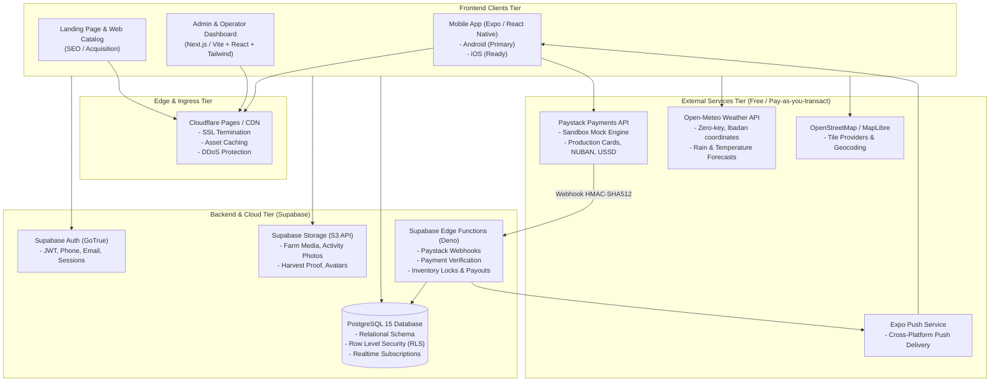
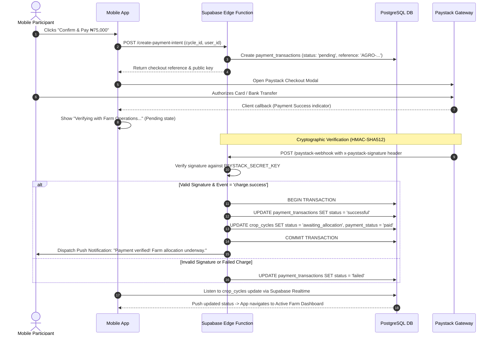

# TECHNICAL ARCHITECTURE: AGROCONNECT PLATFORM

## 1. System Topology & Overview

The AgroConnect platform uses a decoupled, mobile-first architecture powered by a managed backend-as-a-service (Supabase) to minimize operational overhead while guaranteeing enterprise-grade PostgreSQL relational guarantees, strict Row Level Security (RLS), and zero initial cloud infrastructure costs.



---

## 2. Technology Stack Breakdown

| Layer | Selected Technology | Rationale & Commercial Validity | Free Tier / Cost Profile |
| :--- | :--- | :--- | :--- |
| **Mobile Client** | **React Native + Expo (SDK 52+)** with TypeScript & Expo Router | Cross-platform (Android-first, iOS ready), rapid iteration with Expo Go, robust camera and file upload modules. File-based routing matches modern web paradigms. | 100% Free & Open Source (Apache 2.0). Free local builds via Expo CLI. |
| **Web Admin & Landing** | **Next.js (App Router) / React (Vite)** + Tailwind CSS + Lucide Icons | Fast server-side rendering for public SEO landing page; highly responsive, modular interface for administrative back-office operations. | 100% Free & Open Source (MIT). |
| **Backend & Database** | **Supabase (PostgreSQL 15)** | True relational integrity with foreign keys, JSONB support for itemized budgets, Row Level Security (RLS) ensuring bulletproof multi-tenant isolation. | Free Tier: 500MB DB, 1GB File Storage, 50k MAU, 500k Edge Function invocations/month. |
| **Authentication** | **Supabase Auth** | Built-in JWT generation, role claims, secure session refreshing, email and phone SMS provider compatibility. | Included in free tier (up to 50,000 monthly active users). |
| **File Storage** | **Supabase Storage** | S3-compatible object storage with image transformation capabilities and granular bucket RLS policies. | 1GB free tier. Organized into dedicated buckets (`farm-media`, `activities`, `harvests`). |
| **Maps & Geospatial** | **OpenStreetMap (OSM) + Leaflet / MapLibre** | High-fidelity mapping of Ibadan and Nigerian agricultural zones without Google Maps API credit card requirements or billing risks. | Free with standard tile usage policy and attribution compliance. |
| **Weather Forecasts** | **Open-Meteo API** | Non-commercial and transparent commercial terms, no API keys required, hourly and 7-day precipitation/temperature forecasts for Ibadan coordinates (`7.3775° N, 3.9470° E`). | Free tier allows up to 10,000 daily API calls. |
| **Payments** | **Paystack API (with Sandbox Abstraction)** | The standard for Nigerian digital commerce (Cards, Bank Transfer, USSD, NUBAN verification). | 100% free test sandbox; production fee is transaction-based (1.5% + ₦100) with zero monthly fixed charge. |
| **Push Notifications**| **Expo Push Notification Service** | Unified push abstraction communicating directly with Google FCM and Apple APNs without individual certificate management overhead. | 100% Free. |

---

## 3. Monorepo Repository Structure

To avoid code duplication and guarantee type safety between the mobile app, admin portal, and database schemas, the codebase is structured as a clean workspace monorepo:

```
farm-project/
├── apps/
│   ├── mobile/                    # React Native Expo Mobile App
│   │   ├── app/                   # Expo Router File-Based Navigation
│   │   │   ├── (auth)/            # Login, Register, Forgot Password
│   │   │   ├── (tabs)/            # Home, Discover, My Farms, Marketplace, Profile
│   │   │   ├── farm/[id].tsx      # Farm details & plot availability
│   │   │   ├── crop/[id].tsx      # Crop guide & package selector
│   │   │   ├── calculator.tsx     # Dynamic production budget estimator
│   │   │   ├── checkout.tsx       # Production order review & payment trigger
│   │   │   ├── cycle/[id].tsx     # Live farming timeline & activity feed
│   │   │   └── harvest/[id].tsx   # Post-harvest decision engine (eat vs sell)
│   │   ├── components/            # Reusable UI Components (Cards, Buttons, Badges)
│   │   ├── hooks/                 # Custom React hooks (useAuth, useFarm, useWeather)
│   │   ├── services/              # Supabase client, Paystack service, OSM client
│   │   ├── app.json               # Expo configuration
│   │   ├── package.json
│   │   └── tsconfig.json
│   │
│   └── admin/                     # Web Admin Portal (Next.js / Vite React)
│       ├── src/
│       │   ├── app/pages/         # Dashboard, Farms, Crops, Cycles, Approvals, Orders
│       │   ├── components/        # Admin tables, data filters, image approval cards
│       │   └── lib/               # Supabase admin client (Service Role protected)
│       ├── package.json
│       └── tsconfig.json
│
├── packages/
│   └── shared/                    # Shared TypeScript Types & Business Logic
│       ├── src/
│       │   ├── types/             # Database entity types, API contracts, DTOs
│       │   ├── calculations/      # Production budget formula, cost-per-kg formulas
│       │   ├── constants/         # Ibadan LGAs, Crop categories, Lifecycle stages
│       │   └── validation/        # Zod validation schemas
│       ├── package.json
│       └── tsconfig.json
│
├── supabase/                      # Supabase Local & Remote Configuration
│   ├── migrations/                # Version-controlled SQL migration scripts
│   ├── seed.sql                   # Development seed data (Ibadan farms, crops, packages)
│   ├── functions/                 # Supabase Edge Functions (Deno)
│   │   ├── paystack-webhook/      # Secure payment verification & order activation
│   │   ├── allocate-plot/         # Transactional plot reservation logic
│   │   └── settle-seller/         # Automated payout ledger generation
│   └── config.toml
│
├── docs/                          # Project documentation
├── package.json                   # Root package.json (workspaces)
└── README.md
```

---

## 4. Payment Architecture & Verification Model

Financial transactions must be bulletproof. A common architectural failure in amateur mobile apps is relying on frontend confirmation messages to update database records. AgroConnect implements a **Strict Server-Side Verification Model**:



### Modular Payment Gateway Interface
The application abstracts payments behind a strict TypeScript contract:

```typescript
export interface PaymentGateway {
  initializePayment(params: PaymentInitParams): Promise<PaymentInitResult>;
  verifyTransaction(reference: string): Promise<PaymentVerificationResult>;
  handleWebhook(payload: any, signature: string): Promise<WebhookResult>;
}
```
This allows running the entire application in **Sandbox Mock Mode** during initial development and testing without making external network calls, then toggling to **Paystack Live** simply by supplying environment variables.

---

## 5. Security & Row Level Security (RLS) Strategy

1. **Service Role Isolation**: The high-privilege `service_role` key is strictly kept in secure backend environments (Supabase Edge Functions / Admin API routes) and **never embedded in the mobile application bundle**.
2. **Row Level Security (RLS)**: Every single table in the PostgreSQL database has RLS enabled by default.
   - *Participants* can only `SELECT` and `UPDATE` their own profile, production orders, and private harvest choices.
   - *Participants* can only `SELECT` published farms, active crops, and **approved** farming activities.
   - *Farmers* can only `INSERT` and `UPDATE` activities for plots explicitly assigned to them.
   - *Admins* possess unrestricted read/write capabilities governed by role verification checks in PostgreSQL helper functions (`auth.jwt() ->> 'role' = 'admin'`).
3. **Storage Bucket Policies**:
   - `farm-media` (Public read; Admin/Farmer write).
   - `activity-updates` (Public read for approved items; Farmer write to assigned cycle folder).
   - `harvest-evidence` (Restricted read to participant and admin; Farmer write).

---

## 6. Offline-First & Network Resilience

In Nigerian mobile environments, network connectivity can be unstable:
- **Mobile Caching**: `React Query` / `@tanstack/react-query` with persistence handles API caching and optimistic UI updates.
- **Image Optimization**: Media uploads from farmers are compressed on the client device (using `expo-image-manipulator`) before transmission to reduce bandwidth and storage consumption.
- **Retry Mechanics**: Failed payment verification queries utilize exponential backoff.
